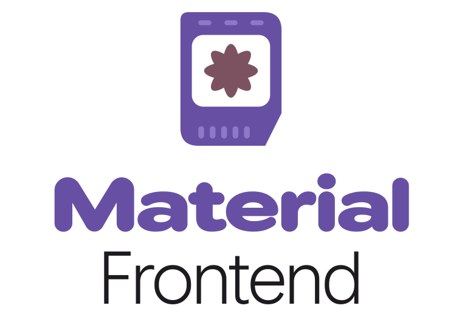
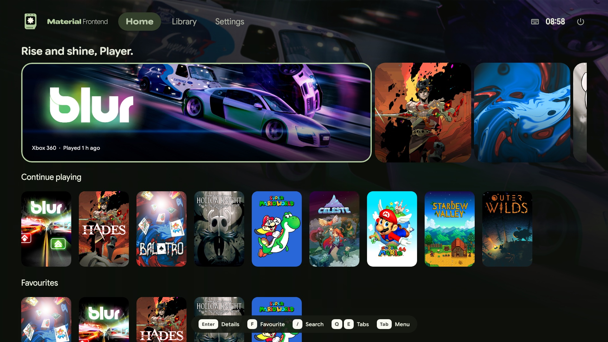
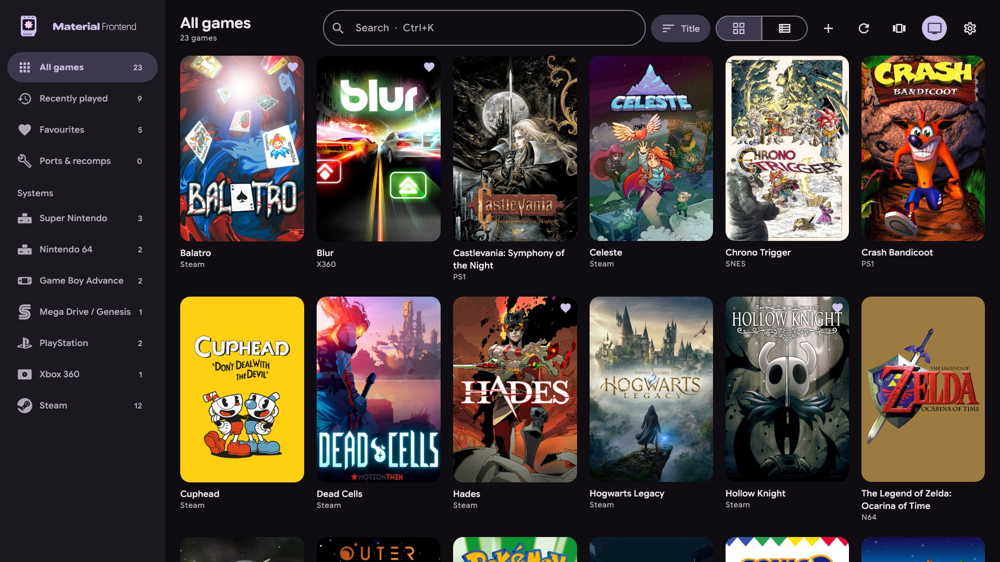
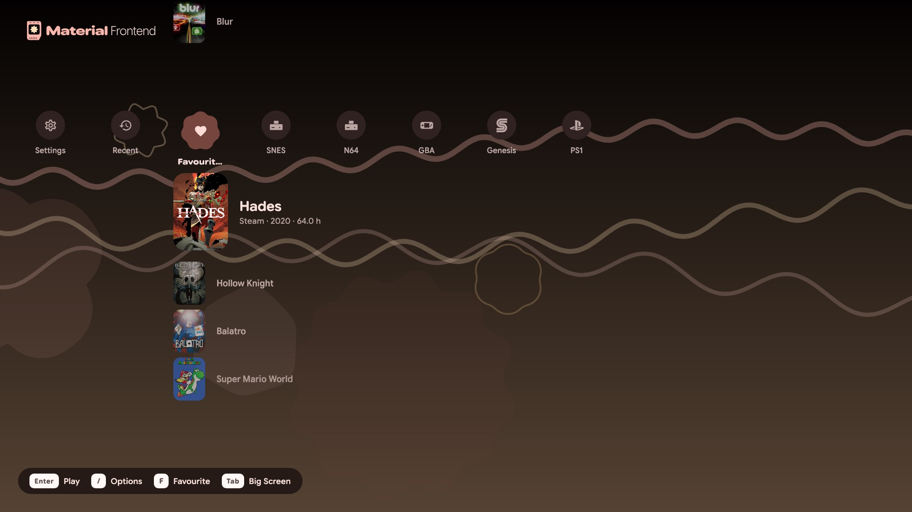
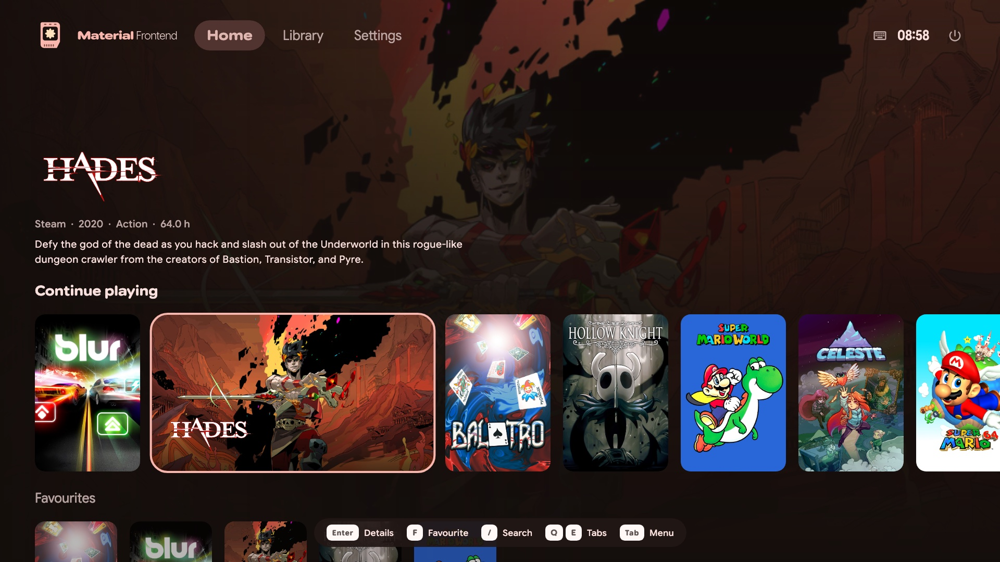
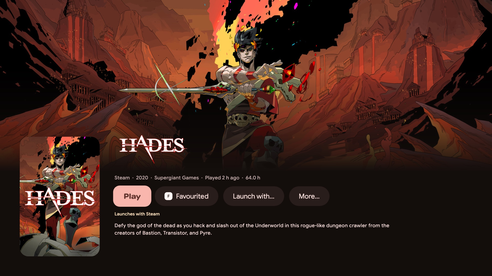

<p align="center">
  <picture>
    <source media="(prefers-color-scheme: dark)" srcset="docs/brand/wordmark-stacked-dark.svg">
    
  </picture>
</p>

> **Work in progress.** Things are changing quickly and some features are still rough around the edges.

A game library and emulation frontend for **Windows, macOS and Linux**, designed with Material 3 Expressive and built with Compose Multiplatform. It brings your PC launchers and your emulated systems together in one place, and you can browse it three ways: a desktop library, a controller-first Big Screen mode, or a PS3-inspired XMB.

By [XDan](https://xdan.cc).



## Screenshots

| | |
|---|---|
|  **Library view** |  **XMB** |
|  **Big Screen shelves** |  **Game page** |

## Features

### Three ways to browse
- **Library view:** a Steam-style grid or table with sorting, filters, collections, multi-select and Ctrl+K quick launch.
- **Big Screen:** made for the sofa and a controller. A greeting for the time of day, a spotlight you can set to recent, favourite, random or hand-picked games, shelves whose focused card opens up into its wide art, a game page, search with an on-screen or physical keyboard, and a power menu.
- **XMB:** a cross-media bar with settings pages, a PS3-style options sidebar, and animated backgrounds (ribbons, floating shapes, squiggles or a mix) that follow the time of day.

Settings are shared across all three, so a change in one shows up everywhere.

### Play
- **Built-in player:** libretro cores run inside the app, with save states, rewind, fast-forward, a CRT/LCD filter, core options, disc swapping, per-game or per-system button remapping and up to four players. Cores that need OpenGL (N64, PSP, Dreamcast and more) run too.
- **Standalone emulators:** detected automatically and launched with the right arguments. That includes RetroArch, DuckStation, PCSX2, RPCS3, shadPS4, Vita3K, PPSSPP, Dolphin, Cemu, Ryujinx/Ryubing, Citron, Eden, Azahar, melonDS, xemu, Xenia, Flycast, mGBA, Mesen, ares, MAME and more. If one isn't recognised, you can add it yourself.
- **Ports, recomps and decomps:** point at the executable; the game and its original system are guessed and can be edited.
- **RetroAchievements:** sign in to see your progress, points and badges on game pages.

### Your library
- **PC launchers:** Steam, Epic Games, EA app, Xbox, GOG Galaxy, Ubisoft Connect, Battle.net, itch.io, Heroic and Lutris.
- **CrossOver and Parallels:** Windows games installed through CrossOver bottles or a Parallels VM show up and launch from macOS.
- **Games you own but haven't installed:** Steam and Heroic games appear greyed out with an Install button, when your machine can run them.
- **Only what you can play:** emulators are found first, and game files are only picked up for systems you can actually run. New emulators and launchers are offered when they appear.
- **Existing setups:** ES-DE / EmulationStation and Pegasus metadata and art are imported.
- **Hide, rename, remove, favourite** from any view.

### Artwork
- Covers, wide art and logos from SteamGridDB, IGDB, libretro-thumbnails and Steam.
- Sharp or blurred hero art.
- Logo placement on a 3×3 grid with adjustable size, starting from Steam's own default for each game, and per-game overrides.
- Platform logos for every system.

### Controllers and input
- Xbox, PlayStation, Nintendo, Steam and 8BitDo controllers with matching button prompts, hot-plugging and a Nintendo-style confirm option.
- Every frontend action can be remapped to a key or controller button.
- Controllers are ignored while another app is in front, and the built-in player pauses until you come back.

### Setup
A short guided setup asks what you'll use the app for (PC games, emulation or both) and only asks what's relevant from there: which view you prefer, light or dark, your launchers, game folders, emulators, cores, BIOS files and artwork.

## Getting started

There are no releases yet. Until then, every push builds installers for Windows, macOS (Apple Silicon and Intel) and Linux (x64 and arm64) in [GitHub Actions](../../actions), or you can build it yourself. The macOS builds aren't signed yet, so right-click the app and choose **Open** the first time.

### Building from source

You only need a JDK (11 or newer) to start Gradle; the build downloads the JDK it needs.

```bash
./gradlew :composeApp:run                                   # run
./gradlew :composeApp:run --args="--bigscreen"              # start in Big Screen (or --xmb)
./gradlew :composeApp:packageDistributionForCurrentOS       # build an installer
```

Your data (settings, library, cores, saves and artwork) lives in:

| OS | Location |
|---|---|
| macOS | `~/Library/Application Support/MaterialFrontend` |
| Windows | `%APPDATA%\MaterialFrontend` |
| Linux | `~/.local/share/material-frontend` |

## Controls

| | Controller | Keyboard |
|---|---|---|
| Navigate | D-pad / left stick | Arrows |
| Confirm / Back | A / B (✕ / ○) | Enter / Esc |
| Favourite · Search / options | X · Y | F · / |
| Tabs · Pages | LB / RB · LT / RT | Q / E · [ / ] |
| Menu | Start | Tab |
| In-game menu | Guide, or Select + Start | Esc / F1 |
| Fast-forward | Select + RB | Hold Tab |
| Rewind | Hold Select + LB | Hold Backspace |
| Save / load state | In-game menu | F5 / F7 |

In game, the keyboard acts as a controller: arrows for the D-pad, Z / X / A / S for the face buttons, Q / W for the shoulders, Enter for Start and Shift for Select. Toggle fullscreen with F11 (Windows, Linux) or ⌃⌘F (macOS).

## Roadmap

- Vulkan and OpenGL ES cores
- Earning RetroAchievements while playing in the built-in player
- Owned games straight from GOG Galaxy and the Epic launcher (Heroic covers both today)
- Amazon Games app (Windows)

## Credits

- **Type:** [Google Sans Flex](https://fonts.google.com/specimen/Google+Sans+Flex) (SIL Open Font License).
- **Platform logos:** [Simple Icons](https://simpleicons.org) (CC0). Logos remain the trademarks of their owners. Systems not covered by Simple Icons use original hardware outlines.
- **Screenshots** show a demo library; game artwork belongs to its respective owners.

BIOS files, firmware and keys are never downloaded. You supply your own.
